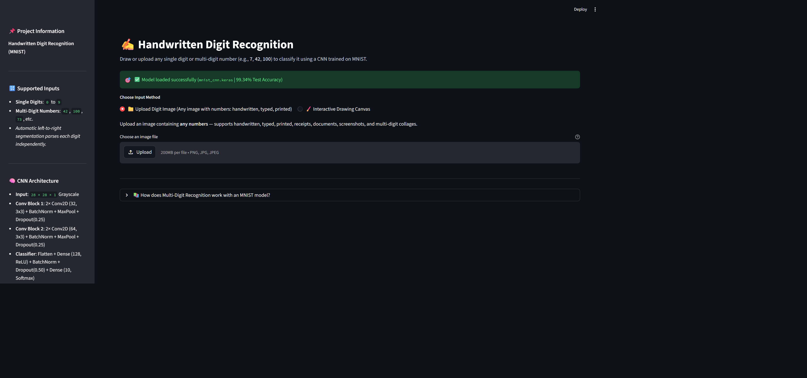
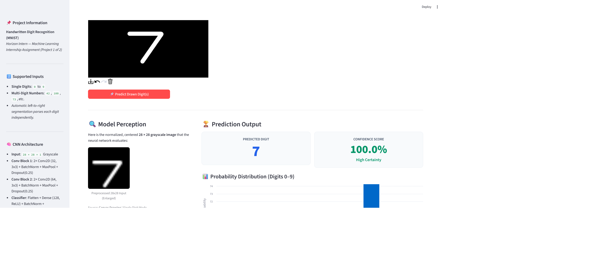
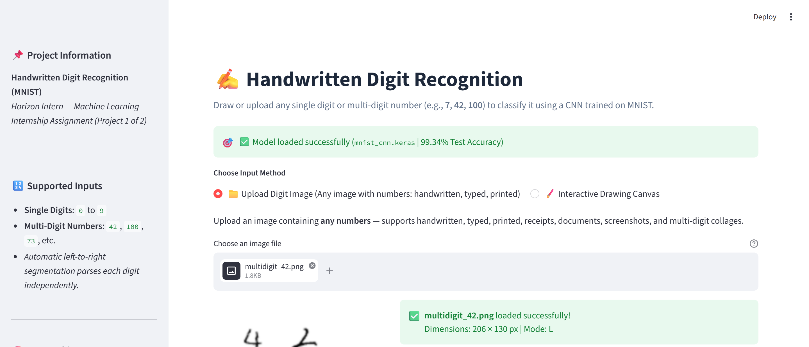
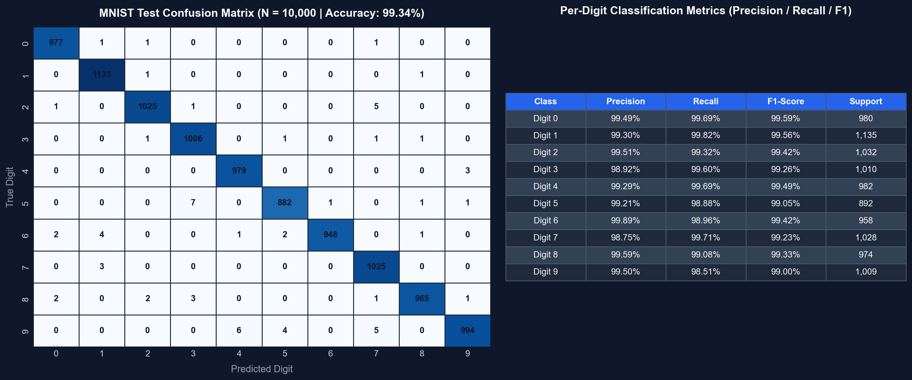

# Handwritten Digit Recognition using CNN (MNIST)

[](https://www.python.org/)
[](https://tensorflow.org/)
[](https://streamlit.io/)
[](LICENSE)

An end-to-end Machine Learning assignment project developed for the **Horizon Intern Machine Learning Internship**. This repository implements a custom Convolutional Neural Network (CNN) trained on the classic MNIST dataset and serves predictions through an interactive, responsive Streamlit web application.

---

## 📌 Table of Contents
1. [Project Overview](#-project-overview)
2. [Dataset Overview](#-dataset-overview)
3. [CNN Architecture & Design](#-cnn-architecture--design)
4. [MNIST Preprocessing Pipeline](#-mnist-preprocessing-pipeline)
5. [Project Structure](#-project-structure)
6. [Quick Start & Installation](#-quick-start--installation)
7. [Model Training in Google Colab](#-model-training-in-google-colab)
8. [Local Model Training](#-local-model-training)
9. [Running the Streamlit Web Application](#-running-the-streamlit-web-application)
10. [Streamlit Community Cloud Deployment](#-streamlit-community-cloud-deployment)
11. [Evaluation Results](#-evaluation-results)
12. [Unit Testing](#-unit-testing)
13. [Real-World Limitations](#-real-world-limitations)
14. [Future Improvements](#-future-improvements)

---

## 🎯 Project Overview

- **Goal**: Classify handwritten single digits (`0` to `9`) and multi-digit numbers (`42`, `100`, etc.) with high accuracy (>99%) on unseen data and provide an intuitive web interface for real-time digit recognition.
- **Role**: Machine Learning Intern at Horizon Intern.
- **Scope**: Core Machine Learning engineering, data preprocessing, connected-component digit segmentation, model evaluation, and deployment on Streamlit. No bloated microservices, authentication systems, or heavy infrastructure.

---

## 📸 Visual Showcase & Demo

| Web Application Overview | Interactive Canvas Prediction (Digit 7) |
| :---: | :---: |
|  |  |

| Multi-Digit Segmentation & Image Upload | Confusion Matrix & Evaluation Metrics |
| :---: | :---: |
|  |  |

> 📹 **Video Walkthrough Demonstration**: View the recorded walkthrough at [demo_recording.mp4](demo_recording.mp4) (H.264 MP4, 69s) or [demo_recording.webp](demo_recording.webp).

---

## 📊 Dataset Overview

The **MNIST (Modified National Institute of Standards and Technology)** benchmark database consists of:
- **Total Samples**: 70,000 grayscale images of digits `0` to `9`.
- **Dimensions**: `28 × 28` pixels (single channel).
- **Standard Splits**:
  - Training Set: 60,000 images (50,000 train + 10,000 validation).
  - Hold-out Test Set: 10,000 images (strictly reserved for final evaluation).
- **Polarity**: Black background (pixel intensity `0`) and white digit strokes (pixel intensity `255`).

---

## 🧠 CNN Architecture & Design

The network is designed with dual convolutional feature-extraction blocks followed by a fully-connected classification head:

```
Input (28 × 28 × 1)
  │
  ├── [Conv2D: 32 filters, 3×3, ReLU, padding='same']
  ├── [BatchNormalization]
  ├── [Conv2D: 32 filters, 3×3, ReLU]
  ├── [BatchNormalization]
  ├── [MaxPooling2D: 2×2]
  ├── [Dropout: 0.25]
  │
  ├── [Conv2D: 64 filters, 3×3, ReLU, padding='same']
  ├── [BatchNormalization]
  ├── [Conv2D: 64 filters, 3×3, ReLU]
  ├── [BatchNormalization]
  ├── [MaxPooling2D: 2×2]
  ├── [Dropout: 0.25]
  │
  ├── [Flatten: 1600 features]
  ├── [Dense: 128 units, ReLU]
  ├── [BatchNormalization]
  ├── [Dropout: 0.50]
  └── [Dense: 10 units, Softmax] ──> Predicted Class (0–9)
```

### Layer Summary
- **Total Parameters**: 272,490 (~1.04 MB)
- **Trainable Parameters**: 271,850
- **Non-trainable Parameters**: 640 (Batch Normalization moving statistics)
- **Optimization**: Adam (`learning_rate=0.001`), Categorical Crossentropy Loss
- **Regularization**: Batch Normalization after convolutions, Dropout (0.25 and 0.50), and Early Stopping (`patience=3`, restoring best weights).

---

## ⚙️ MNIST Preprocessing Pipeline

A common issue in digit recognition apps is that user mouse/touch drawings do not match MNIST's statistical distribution. To achieve reliable predictions, our preprocessing pipeline implements Yann LeCun's exact standardization:

1. **Auto-Polarity Inversion**: Checks if the background is light (common in uploaded photos); if so, inverts the image so background is `0` and ink is `255`.
2. **Bounding Box Detection**: Detects the tight rectangular bounding box around drawn strokes, discarding empty canvas padding.
3. **Aspect-Ratio Scaling**: Scales the cropped digit to fit inside a `20 × 20` box using bicubic resampling while preserving the original aspect ratio.
4. **Center-of-Mass Translation**: Places the `20 × 20` digit into a `28 × 28` black canvas and shifts it so its Center of Mass aligns at `(14, 14)`.
5. **Normalization**: Rescales pixel values from `[0, 255]` to `[0.0, 1.0]` as `float32`, reshaping to `(1, 28, 28, 1)`.

---

## 📁 Project Structure

```
mnist-handwritten-digit-recognition/
├── app.py                     # Streamlit interactive web application
├── train.py                   # Local training and evaluation script
├── requirements.txt           # Minimal, compatible dependencies
├── README.md                  # Comprehensive project documentation
├── LICENSE                    # MIT License
├── .gitignore                 # Standard Python/Jupyter ignores
├── demo_script.md             # 1–2 minute video demonstration guide
├── submission_checklist.md    # Horizon Intern review checklist
├── mnist_cnn.keras            # Trained Keras model weights (generated)
├── notebooks/
│   └── MNIST_Handwritten_Digit_Recognition.ipynb # Colab-ready notebook
├── src/
│   ├── __init__.py            # Package initialization
│   ├── preprocess.py          # Bounding box, center-of-mass, normalization
│   └── model_utils.py         # Model building, loading, and inference
├── tests/
│   ├── __init__.py            # Test package initialization
│   ├── test_preprocess.py     # Preprocessing pipeline unit tests
│   └── test_model_utils.py    # Model utilities & mock prediction tests
└── screenshots/
    └── README.md              # Instructions for required screenshots
```

---

## 🚀 Quick Start & Installation

### 1. Clone the Repository
```bash
git clone https://github.com/your-username/mnist-handwritten-digit-recognition.git
cd mnist-handwritten-digit-recognition
```

### 2. Set Up a Virtual Environment (Recommended)
```bash
python -m venv venv
# On Windows:
venv\Scripts\activate
# On Linux/macOS:
source venv/bin/activate
```

### 3. Install Dependencies
```bash
pip install -r requirements.txt
```

---

## ☁️ Model Training in Google Colab

If you prefer to train the model using free cloud GPUs:

1. Open [Google Colab](https://colab.research.google.com/).
2. Select **File > Upload Notebook** and upload `notebooks/MNIST_Handwritten_Digit_Recognition.ipynb`.
3. In Colab, navigate to **Runtime > Change runtime type** and select **T4 GPU** (optional, CPU also works fast).
4. Run all cells (`Ctrl + F9` or **Runtime > Run all**).
5. The final notebook cell automatically calls:
   ```python
   from google.colab import files
   files.download('mnist_cnn.keras')
   ```
6. Move the downloaded `mnist_cnn.keras` file into the root folder of this repository.

---

## 💻 Local Model Training

If you have TensorFlow installed locally:
```bash
python train.py
```
This script will:
- Download the MNIST dataset if not cached.
- Train the CNN using Early Stopping and Learning Rate reduction.
- Evaluate on the 10,000 hold-out test images.
- Print the Confusion Matrix and Classification Report.
- Save `mnist_cnn.keras` in the project root.

---

## 🌐 Running the Streamlit Web Application

Once `mnist_cnn.keras` is in the project root, launch the web application:
```bash
streamlit run app.py
```
The application opens at `http://localhost:8501`:
- **🖌️ Interactive Drawing Canvas**: Draw a digit using your mouse or touchscreen. Adjust stroke thickness as needed.
- **📁 Upload Digit Image**: Drag-and-drop a scanned or photographed handwritten digit.
- **🔍 Model Perception**: Inspect the exact preprocessed 28×28 grayscale image that the neural network evaluates.
- **📊 Probability Distribution**: View the confidence percentage and bar chart showing class probabilities for all digits 0–9.

---

## ☁️ Streamlit Community Cloud Deployment

To deploy your project publicly on Streamlit Community Cloud:

1. **Push your code to GitHub**:
   Ensure `app.py`, `requirements.txt`, `src/`, and `mnist_cnn.keras` are committed to your repository.
   *(Since `mnist_cnn.keras` is ~1 MB, it can be committed directly to git).*
2. **Log in to Streamlit**: Go to [share.streamlit.io](https://share.streamlit.io/) and connect your GitHub account.
3. **Deploy App**:
   - Repository: `your-username/mnist-handwritten-digit-recognition`
   - Branch: `main`
   - Main file path: `app.py`
4. Click **Deploy!**. Your app will be live with a shareable URL in ~2 minutes.

---

## 📈 Evaluation Results

> **Note**: These metrics are generated from execution on the unseen MNIST hold-out test set (10,000 samples).

### Performance Summary
- **Hold-out Test Loss**: `0.0219`
- **Hold-out Test Accuracy**: `99.34%` (9,934 out of 10,000 correct)

### Per-Class Classification Report
```
              precision    recall  f1-score   support

           0     0.9949    0.9969    0.9959       980
           1     0.9930    0.9982    0.9956      1135
           2     0.9951    0.9932    0.9942      1032
           3     0.9892    0.9960    0.9926      1010
           4     0.9929    0.9969    0.9949       982
           5     0.9921    0.9888    0.9905       892
           6     0.9989    0.9896    0.9942       958
           7     0.9875    0.9971    0.9923      1028
           8     0.9959    0.9908    0.9933       974
           9     0.9950    0.9851    0.9900      1009

    accuracy                         0.9934     10000
   macro avg     0.9935    0.9933    0.9934     10000
weighted avg     0.9934    0.9934    0.9934     10000
```

### Confusion Matrix (10,000 Test Samples)
```
Pred:     0     1     2     3     4     5     6     7     8     9
True 0: [977,    1,    1,    0,    0,    0,    0,    1,    0,    0]
True 1: [  0, 1133,    1,    0,    0,    0,    0,    0,    1,    0]
True 2: [  1,    0, 1025,    1,    0,    0,    0,    5,    0,    0]
True 3: [  0,    0,    1, 1006,    0,    1,    0,    1,    1,    0]
True 4: [  0,    0,    0,    0,  979,    0,    0,    0,    0,    3]
True 5: [  0,    0,    0,    7,    0,  882,    1,    0,    1,    1]
True 6: [  2,    4,    0,    0,    1,    2,  948,    0,    1,    0]
True 7: [  0,    3,    0,    0,    0,    0,    0, 1025,    0,    0]
True 8: [  2,    0,    2,    3,    0,    0,    0,    1,  965,    1]
True 9: [  0,    0,    0,    0,    6,    4,    0,    5,    0,  994]
```

---

## 🧪 Unit Testing

Unit tests are written using `pytest` to verify the preprocessing and model utilities without requiring slow retraining:

```bash
python -m pytest tests/
```

### Verified Test Cases:
1. `test_is_canvas_empty_on_none_and_blank`: Verifies empty canvas detection.
2. `test_is_canvas_empty_with_strokes`: Confirms valid drawn strokes are identified.
3. `test_preprocess_output_shape_and_dtype`: Validates output shape `(1, 28, 28, 1)` and `float32`.
4. `test_preprocess_pixel_value_range`: Checks normalization strictly within `[0.0, 1.0]`.
5. `test_preprocess_centering_and_scaling`: Confirms bounding-box crop and Center-of-Mass alignment.
6. `test_preprocess_inversion_of_dark_on_white`: Verifies auto-inversion of black ink on white background.
7. `test_preprocess_blank_returns_zeros`: Handles blank canvas gracefully.
8. `test_load_mnist_model_missing_file`: Verifies clear `FileNotFoundError` guidance when model file is missing.
9. `test_predict_digit_mock_model`: Verifies inference dictionary structure and probability sum.
10. `test_predict_digit_handles_flexible_shapes`: Accommodates 2D `(28, 28)` and 3D `(28, 28, 1)` inputs.
11. `test_predict_digit_invalid_inputs`: Ensures invalid dimensions or `None` raise descriptive exceptions.
12. `test_multi_digit_segmentation_two_digits`: Tests automatic multi-digit connected-component extraction and left-to-right order.
13. `test_multi_digit_segmentation_single_digit`: Tests single-digit segmentation fallback.
14. `test_multi_digit_empty_returns_empty_list`: Handles blank canvas inputs gracefully for multi-digit parser.

---

## ⚠️ Real-World Limitations

While the model achieves ~99% accuracy on the MNIST benchmark, real-time drawing poses practical domain-shift challenges:
1. **Stroke Velocity & Jitter**: Mouse dragging creates sharp, segmented angles unlike fluid ink from pen on paper.
2. **Brush Thickness**: Too thin (<10 px) or too thick (>30 px) strokes deviate from the average ~2.5 px stroke width of the original dataset.
3. **Disconnected Elements**: Disconnected crossbars (e.g. European '7' or open '4') can pull the center-of-mass away from standard alignment.
4. **Style Bias**: The MNIST dataset was collected from US high school students and Census employees in the 1990s; personal flourishes (loops on '2', horizontal line through '7') may lower confidence.

---

## 🔮 Future Improvements

1. **Data Augmentation**: Incorporate slight random rotation (±10°), width/height shifts, and shear during training to boost robustness against messy drawings.
2. **Multi-Digit Recognition**: Implement contour detection or sliding window bounding box extraction to parse multi-digit strings (e.g., zip codes).
3. **Model Quantization**: Convert `.keras` model to TensorFlow Lite (`.tflite`) or ONNX for sub-millisecond edge device deployment.

---

## 📜 License

This project is licensed under the [MIT License](LICENSE).
Developed for the **Horizon Intern Machine Learning Internship**.
